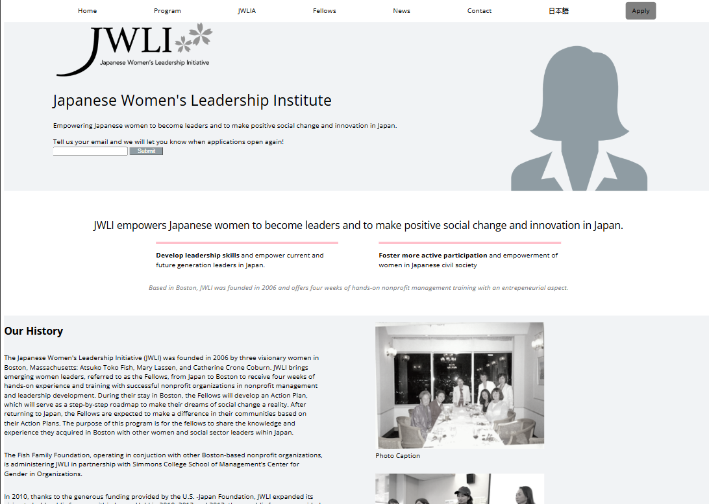

# JWLI
JWLI Project Wireframe

# JWLI

## Project Description

A simple wireframe for  a Boston nonprofit empowering Japanese women leaders, built around mission storytelling and newsletter and application signups. 

### How It's Made:
Tech used: HTML & CSS

## How to Run or View It

1. Clone or download the repository.
2. Open `index.html` in a browser

## View Live Deploy
https://jwlinstitute.netlify.app/

## Screenshots and Demo

### Application Interface

